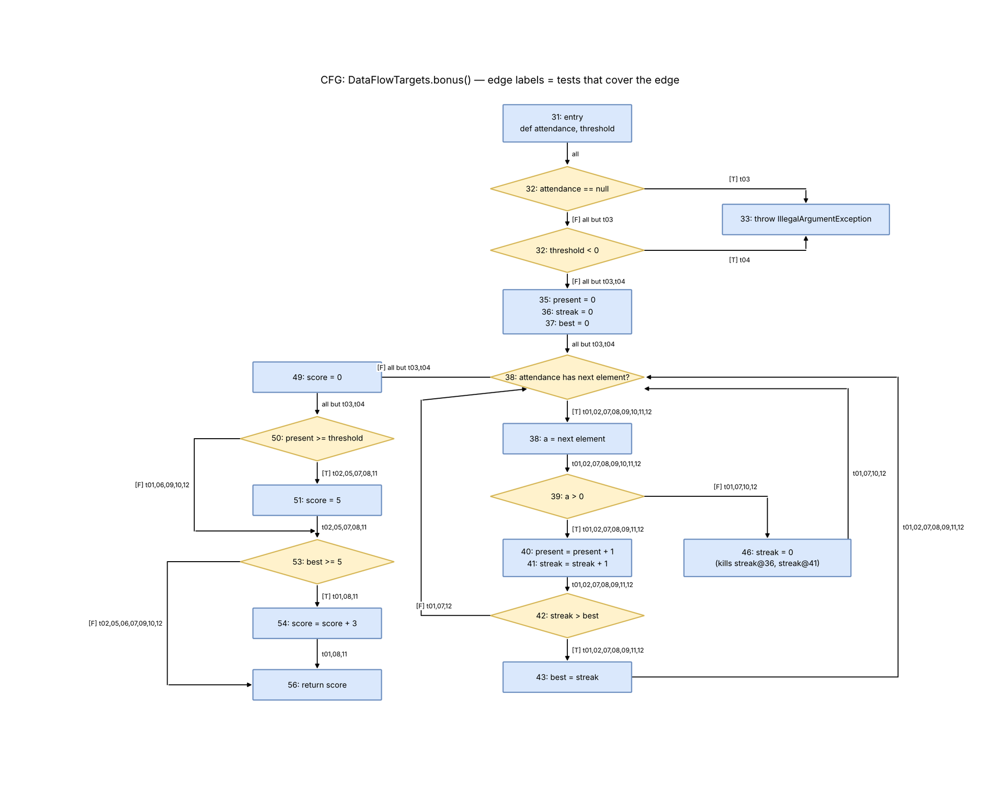

# Лаб 10 — Өгөгдлийн урсгалын тест (Definition-Use хосууд)

- Нэр: Э.Номинзул
- Оюутны код: B242270082

`java -version`:
```
openjdk version "21.0.10-internal" 2026-01-20
OpenJDK Runtime Environment (build 21.0.10-internal-adhoc.rattler.src)
OpenJDK 64-Bit Server VM (build 21.0.10-internal-adhoc.rattler.src, mixed mode, sharing)
```

`mvn -version`:
```
Apache Maven 3.9.9
Maven home: /usr/share/maven
Java version: 21.0.10-internal, vendor: N/A, runtime: /home/nominzul/miniforge3/lib/jvm
Default locale: en_US, platform encoding: UTF-8
OS name: "linux", version: "6.12.107+deb13-amd64", arch: "amd64", family: "unix"
```

## Хэсэг A: gcd — DU хосуудын бүрэн хүснэгт

Мөрийн дугаар нь `DataFlowTargets.java` файлын мөр: 13 (параметр x, y def), 14 (`int tmp;` — def биш), 15 (`while (y != 0)`), 16 (`tmp = x % y`), 17 (`x = y`), 18 (`y = tmp`), 20 (`return x`).

Def / use жагсаалт:

| Мөр | Def | c-use | p-use |
|---|---|---|---|
| 13 | x, y | | |
| 15 | | | y |
| 16 | tmp | x, y | |
| 17 | x | y | |
| 18 | y | tmp | |
| 20 | | x | |

DU хос (p-use бүрийг T/F салаагаар нь тусад нь тоолсон: нийт **13** хос: c-use 9, p-use 4 (y@15-ийн T/F × 2 def)):

| ID | Хувьсагч | Def мөр | Use мөр | c/p | Def-clear зам | Тестийн ID | Хамрагдсан |
|---|---|---|---|---|---|---|---|
| X1 | x | 13 | 16 | c | 13→15→16 | G1, G3 | тийм |
| X2 | x | 13 | 20 | c | 13→15→20 | **G2** (ганцаараа) | тийм |
| X3 | x | 17 | 16 | c | 17→18→15→16 | G1 | тийм |
| X4 | x | 17 | 20 | c | 17→18→15→20 | G1, G3 | тийм |
| Y1 | y | 13 | 15 | p (T) | 13→15→16 | G1, G3 | тийм |
| Y2 | y | 13 | 15 | p (F) | 13→15→20 | **G2** (ганцаараа) | тийм |
| Y3 | y | 13 | 16 | c | 13→15→16 | G1, G3 | тийм |
| Y4 | y | 13 | 17 | c | 13→15→16→17 | G1, G3 | тийм |
| Y5 | y | 18 | 15 | p (T) | 18→15→16 | G1 | тийм |
| Y6 | y | 18 | 15 | p (F) | 18→15→20 | G1, G3 | тийм |
| Y7 | y | 18 | 16 | c | 18→15→16 | G1 | тийм |
| Y8 | y | 18 | 17 | c | 18→15→16→17 | G1 | тийм |
| T1 | tmp | 16 | 18 | c | 16→17→18 | G1, G3 | тийм |

Тэмдэглэл: `tmp`-ийн def нь зөвхөн 16, use нь зөвхөн 18 — нэг хос. 14-р мөрийн `int tmp;` нь утга оноодоггүй тул def биш. `x`-ийн 17-р мөр дэх def нь 17-р мөрт өөрт нь use болдоггүй (`x = y` нь y-г уншина).

### Тестүүд (`GcdTest.java`)

| ID | Тест | Оролт → гаралт | Хамарсан хос |
|---|---|---|---|
| G1 | `gcd_12_8_twoIterations` | gcd(12,8) = 4 | X1 X3 X4 Y1 Y3 Y4 Y5 Y6 Y7 Y8 T1 |
| G2 | `gcd_7_0_loopSkipped` | gcd(7,0) = 7 | X2 Y2 |
| G3 | `gcd_0_5_oneIteration` | gcd(0,5) = 5 | X1 X4 Y1 Y3 Y4 Y6 T1 (шинэ хос нэмэхгүй, хилийн тест) |

- **gcd(7,0) ганцаараа хамарна:** X2 (13→20) ба Y2 (13→15 F). Эхний шалгалтад `y == 0` тул давталтын бие огт ажиллахгүй; x, y-ийн анхны def шууд 15, 20 хүрнэ. Давталт ажиллавал 17, 18 нь def-ийг дарна.
- **gcd(12,8) хоёр давталт хийнэ:** (12,8) → tmp=4, x=8, y=4 → tmp=0, x=4, y=0 → гарна. Хоёр давталт хэрэгтэй: X3 (17→16), Y5 (18→15 T), Y7 (18→16), Y8 (18→17) нь өмнөх давталтад тодорхойлогдсон утгыг дараагийн давталтад хэрэглэдэг. Нэг давталт хангалтгүй.

## Хэсэг B: bonus — бүрэн анализ

### B1 — CFG

`cfg-bonus.png`: дараалсан мөрүүдийг нэг зангилаа болгож (35–37, 40–41), 32-р мөрийн нөхцөлийг (`attendance == null`, `threshold < 0`) хоёр зангилаа болгон зурсан; зангилаа бүр файлын мөрийн дугаартай, ирмэг бүрийн хажууд түүнийг дайрдаг тестийн бодит метод нэр бичигдсэн (T/F нь салаа). 38-р мөрийн for-each: нөхцөл = attendance-д дараагийн элемент байгаа эсэх (attendance-ийн p-use), алхам = дараагийн элементийг a-д оноох (a-ийн def, T салаан дээр).



### B2 — Def/Use жагсаалт

| Мөр | Def | c-use | p-use |
|---|---|---|---|
| 31 | attendance, threshold | | |
| 32 | | | attendance, threshold (`\|\|` — attendance == null үед threshold үнэлэгдэхгүй) |
| 35 | present | | |
| 36 | streak | | |
| 37 | best | | |
| 38 | a (T салаан дээр) | | attendance |
| 39 | | | a |
| 40 | present | present | |
| 41 | streak | streak | |
| 42 | | | streak, best |
| 43 | best | streak | |
| 46 | streak | | |
| 49 | score | | |
| 50 | | | present, threshold |
| 51 | score | | |
| 53 | | | best |
| 54 | score | score | |
| 56 | | score | |

### B3 — DU хосын хүснэгт

p-use-ийн хос бүрийг T/F салаагаар нь тусад нь тоолсон. Нийт 35 боломжит хос, үүнээс **2 биелэшгүй** (BE1, BE4), **33 биелэх**.

| ID | Хувьсагч | Def | Use | c/p | Def-clear зам | Тестийн ID | Хамрагдсан |
|---|---|---|---|---|---|---|---|
| AT1 | attendance | 31 | 32 | p F | 31→32 | t01 t02 t04 t05 t06 t07 t08 t09 t10 t11 t12 | тийм |
| AT2 | attendance | 31 | 32 | p T | 31→32 | t03 | тийм |
| AT3 | attendance | 31 | 38 | p F | 31→32→35→36→37→38 | t01 t02 t05–t12 | тийм |
| AT4 | attendance | 31 | 38 | p T | 31→32→35→36→37→38 | t01 t02 t07–t12 | тийм |
| TH1 | threshold | 31 | 32 | p F | 31→32 | t01 t02 t05–t12 | тийм |
| TH2 | threshold | 31 | 32 | p T | 31→32 | t04 | тийм |
| TH3 | threshold | 31 | 50 | p F | 31→…→38→49→50 | t01 t06 t09 t10 t12 | тийм |
| TH4 | threshold | 31 | 50 | p T | 31→…→38→49→50 | t02 t05 t07 t08 t11 | тийм |
| AV1 | a | 38 | 39 | p F | 38→39 | t01 t07 t10 t12 | тийм |
| AV2 | a | 38 | 39 | p T | 38→39 | t01 t02 t07 t08 t09 t11 t12 | тийм |
| PR1 | present | 35 | 40 | c | 35→36→37→38→39→40 | t01 t02 t07 t08 t09 t11 t12 | тийм |
| PR2 | present | 35 | 50 | p F | 35→36→37→38→49→50 | t06 t10 | тийм |
| PR3 | present | 35 | 50 | p T | 35→36→37→38→49→50 | t05 | тийм |
| PR4 | present | 40 | 40 | c | 40→41→42→(43→)38→39→40 | t01 t07 t08 t11 t12 | тийм |
| PR5 | present | 40 | 50 | p F | 40→41→42→(43→)38→49→50 | t01 t09 t12 | тийм |
| PR6 | present | 40 | 50 | p T | 40→41→42→(43→)38→49→50 | t02 t07 t08 t11 | тийм |
| ST1 | streak | 36 | 41 | c | 36→37→38→39→40→41 | t01 t02 t07 t08 t09 t11 t12 | тийм |
| ST2 | streak | 41 | 41 | c | 41→42→(43→)38→39→40→41 | t01 t08 t11 t12 | тийм |
| ST3 | streak | 41 | 42 | p F | 41→42 | t01 t07 t12 | тийм |
| ST4 | streak | 41 | 42 | p T | 41→42 | t01 t02 t07 t08 t09 t11 t12 | тийм |
| ST5 | streak | 41 | 43 | c | 41→42→43 | t01 t02 t07 t08 t09 t11 t12 | тийм |
| ST6 | streak | 46 | 41 | c | 46→38→39→40→41 | t01 t07 t12 | тийм |
| BE1 | best | 37 | 42 | p F | — | — | **биелэшгүй** |
| BE2 | best | 37 | 42 | p T | 37→38→39→40→41→42 | t01 t02 t07 t08 t09 t11 t12 | тийм |
| BE3 | best | 37 | 53 | p F | 37→38→49→50→(51→)53 | t05 t06 t10 | тийм |
| BE4 | best | 37 | 53 | p T | — | — | **биелэшгүй** |
| BE5 | best | 43 | 42 | p F | 43→38→39→40→41→42 | t01 t07 t12 | тийм |
| BE6 | best | 43 | 42 | p T | 43→38→39→40→41→42 | t01 t08 t11 t12 | тийм |
| BE7 | best | 43 | 53 | p F | 43→38→49→50→(51→)53 | t02 t07 t09 t12 | тийм |
| BE8 | best | 43 | 53 | p T | 43→38→49→50→(51→)53 | t01 t08 t11 | тийм |
| SC1 | score | 49 | 54 | c | 49→50→53→54 | t01 | тийм |
| SC2 | score | 49 | 56 | c | 49→50→53→56 | t06 t09 t10 t12 | тийм |
| SC3 | score | 51 | 54 | c | 51→53→54 | t08 t11 | тийм |
| SC4 | score | 51 | 56 | c | 51→53→56 | t02 t05 t07 | тийм |
| SC5 | score | 54 | 56 | c | 54→56 | t01 t08 t11 | тийм |

Тестийн ID `tNN` нь `BonusTest.java` дахь `tNN_...` метод. Хос бүрийн хамралтыг (болон хүснэгтийн бүх тоог) def/use-г мөр мөрөөр дагадаг жижиг скриптээр (CFG дээрх статик хайлт + тест бүрийн динамик мөрдлөг) давхар шалгасан: статик 35 хос = гараар гаргасан 35 хос, биелэх 33 бүгд хамрагдсан.

**Мөр 46 (`streak = 0`) юуг алдгийг (kill):** `streak`-ийн def 36 ба def 41-ийг. else-ээр дайрсан зам (36→…→46, 41→…→46) def-clear биш. Иймд:
- ST1 (36→41) зөвхөн **эхний элемент > 0** үед биелнэ (36→…→41 шууд); хэрэв эхний элемент 0 бол 46 def 36-г алдаж, 41 хүрэх утга 46-аас ирнэ.
- ST2 (41→41) зөвхөн **дараалсан** ирцэд (ирц → ирц) def-clear; завсар нь 0 орвол 46 def 41-ийг алдана.
- ST6 (46→41) нь 0-ийн дараах ирц.

**Kill-ээр тасарч DU хос биш болсон хослолууд:** (36, 42), (36, 43), (46, 42), (46, 43). 42, 43-д хүрэх бүх зам 41 (`streak = streak + 1`)-ийг дайрч streak-ийг дахин тодорхойлдог тул def 36, def 46 хэзээ ч 42/43-д хүрдэггүй (41 алдана). Мөн streak-ийг 46 дараа нь хэрэглэх use (46-аас 42/43 хүртэл) байхгүй, 46-ийн утгыг зөвхөн 41 уншина.

**Биелэшгүй хос:**
- **BE1 (best@37 → 42, F):** 42-д анх хүрэхэд streak нь 41-ээр дөнгөж нэмэгдсэн тул ≥ 1, best нь 37-ийн 0 хэвээр → `streak > best` үргэлж T; F салаа руу def 37-оор ирэх боломжгүй (T болсны дараа 43 best-ийг дахин тодорхойлно).
- **BE4 (best@37 → 53, T):** def 37 53 хүртэл хэвээр байвал 43 хэзээ ч ажиллаагүй, өөрөөр хэлбэл ирсэн өдөр байхгүй, best = 0 < 5 → `best >= 5` үргэлж F.

Мөр 32-ийн тэмдэглэл: `attendance == null || threshold < 0` дээр short-circuit байдаг тул `null` үед threshold-ийн p-use үнэлэгдэхгүй; иймээс TH2 (threshold-ийн T) нь null биш массивтай `threshold < 0` тестээр (t04) тусдаа хамрагдана.

### B4 — Хоёр шатны тест

**Шат 1 — ALL-DEFS: 2 тест** (`t01_allDefs_streakAfterBreak`, `t02_allDefs_singleDayMeetsThreshold`).

Яагаад 2-оос цөөн болохгүй вэ: `score`-ийн def гурав (49, 51, 54). Def 49 use-д хүрэхийн тулд 50 нь F байх ёстой (T бол 51 нь def 49-ийг дарна); def 51 use-д хүрэхийн тулд 50 нь T. Нэг гүйцэтгэлд 50 нэг л салаа авдаг тул 49 ба 51-ийг нэг гүйцэтгэлээр use-д хүргэх боломжгүй → дор хаяж 2 тест. 2 нь хүрэлцээтэй: t01 (present 7 < threshold 8 тул 50 F; best = 5 тул 53 T) нь score@49 (→54) ба score@54 (→56)-ийг, мөн streak@36, @41, @46, best@37, @43, present@35, @40, a@38-ийг use-д хүргэнэ (эхний элемент 1, дунд нь 0 тул streak@36 ба streak@46 хоёулаа use-д хүрнэ). t02 нь score@51 (→56)-ийг хамарна. Параметрийн def (attendance, threshold @31) аль ч энгийн тестээр 32, 38, 50-д хүрнэ.

**Шат 2 — ALL-DU-PAIRS:** t03–t11 нэмсэн , нийт 33 биелэх хос хамрагдсан. Дараа нь Хэсэг C-д M2-ийг унагах t12 нэмсэн (шинэ DU хос нэмдэггүй).

### B5 — JaCoCo

| Үе | Tests run | Branch missed/covered | Line missed/covered |
|---|---|---|---|
| jacoco-alldefs.csv (GcdTest + t01, t02) | 5 | **2 / 14** (14/16) | 2 / 22 |
| jacoco-final.csv (бүх тест) | 15 | **0 / 16** (16/16) | 1 / 23 |

- all-defs хангагдсан ч branch 100% биш: 32-р мөрийн хоёр T салаа (null, threshold < 0) хамрагдаагүй — exception-ийн тест all-defs-д хэрэггүй, учир нь exception замд use-д хүрэх шинэ def байхгүй. Тиймээс all-defs ⇏ branch.
- Эцсийн LINE_MISSED = 1 нь 7-р мөрийн далд constructor (хэвийн; кодыг өөрчлөөгүй).
- **Branch 100% байхад DU хос үлдэж болно:** жишээ нь зөвхөн t01, t02, t03, t04 + GcdTest-ийн тестээр branch 16/16 болдог (t01 нь 38, 39, 42, 50F, 53T; t02 нь 50T, 53F; t03/t04 нь 32-ын T салаа). Харин DU хосоос **PR2, PR3, BE3, SC2, SC3** хамрагдахгүй: PR2/PR3 (present@35 → 50), BE3 (best@37 → 53 F) — эдгээр нь «ирцгүй, массив хоосон/бүгд 0» замыг шаарддаг; SC2 (score@49 → 56) ба SC3 (score@51 → 54) нь 50, 53 салаануудын тусгай хослол (50 F & 53 F; 50 T & 53 T) шаарддаг. Branch хамрал салаа бүрийг тусдаа үздэг, харин DU нь def-ээс use хүртэлх *хослолыг* шаарддаг.

## Хэсэг C: Fault seeding

Мутаци бүрийг `DataFlowTargets.java` дээр шууд хийж, `mvn test` ажиллуулж, `git restore`-оор буцаасан.

| № | Мутаци | Төрөл | Үр дүн | Унасан тест | expected / was |
|---|---|---|---|---|---|
| M1 | 41-р мөр `streak = streak + 1` устгав | Missing update | **баригдсан** (3 унав, 11 ногоон) | t08_streakFiveAtThreshold, t11_longStreakSeven, t01_allDefs_streakAfterBreak | t08: expected `<8>` but was `<5>`; t11: expected `<8>` but was `<5>`; t01: expected `<3>` but was `<0>` |
| M2 | `best = streak;` → `best = present;` | Wrong variable | **АМЬД үлдсэн** (14/14 ногоон) | — | — |
| M3 | давталтын дараа `int total = present + best;` нэмэв | Dead definition | **АМЬД үлдсэн** (14/14 ногоон) | — | — |

(Мутацийн үед тестийн тоо 14: GcdTest 3 + t01–t11; t12 нь M2-оос хойш нэмэгдсэн.)

**M1:** streak хэзээ ч 0-оос ихсэхгүй тул `streak > best` үргэлж F, best = 0 → 5-өдрийн цуваа +3 оноо өгөхгүй. Цуваа шалгадаг тест бүр уна.

**M2 — яагаад амьд үлдэв:** 43-р мөрийн def best нь 42, 53-д use болдог ба бүх хос (BE2, BE5–BE8, …) хамрагдсан. Гэвч DU хамрал нь *def-ээс use хүрсэн эсэх*-ийг шалгадаг, use-д хүрсэн **утга зөв үү** гэдгийг шалгадаггүй. `present >= streak` тул мутант best-ийг жинхэнээсээ их болгож болно; гэхдээ үр дүн нь зөвхөн **мутантын best ≥ 5 боловч жинхэнэ best < 5** үед л өөрчлөгдөнө. Манай тестүүдэд ийм оролт байгаагүй: жишээ нь t01-д `{1,1,0,1,1,1,1,1}`-ийн мутантын сүүлчийн шинэчлэлтэд present = 5, streak = 3 боловч эцэст нь best_mut = 5 ≥ 5 ба жинхэнэ best = 5 ≥ 5 → хоёулаа +3.

**M2-ийг унагах тест (`t12_m2Killer_presentDiffersFromStreak`):** `bonus({1,0,1,0,1,0,1,0,1,1}, 7)` → жинхэнэ best = 2 (цуваа хамгийн ихдээ 2), present = 6 < 7 → 0 оноо. M2-д сүүлийн өдөр streak = 2 > best = 1 тул `best = present = 6` ≥ 5 → +3. Үр дүн M2 хэвээр байхад: t12 унав, `expected: <0> but was: <3>`; бусад 14 тест ногоон. Дараа нь кодыг `git restore`-оор буцаасан.

**M3 — яагаад ямар ч тест унагадаггүй:** `total` нь хэзээ ч уншигдахгүй тул үр дүнд нөлөөлөхгүй, програмын гаралт хэвээр. `javac` ч анхааруулдаггүй (хувьсагч хэрэглэгдээгүй байх нь компайлерын алдаа биш). Үүнийг **статик анализ (IDE inspection / SpotBugs / PMD / SonarQube)** барих ёстой — dead store / unused variable дүрэм. VS Code (Java Language Support)-ийн анхааруулга: `The value of the local variable total is not used`. Харин өгөгдлийн урсгалын үүднээс `total`-ийн def ямар ч use-д хүрдэггүй тул all-defs шалгуурыг хангах боломжгүй: энэ нь хамралтын шалгуур өөрөө dead definition-ийг илрүүлдэг гэсэн үг, гэхдээ тест барих (унах) замаар биш, хамрагдаагүй def гэж.

## Дүгнэлт

DU анализ нь branch хамралтаас илүү: branch зөвхөн салаа бүрийг дайрсан эсэхийг шалгадаг бол DU нь утга үүссэн газраас хэрэглэгдэх газар хүртэл хүрсэн эсэх, kill ба хувьсагч хоорондын хослолыг шалгадаг — branch 16/16 байхад PR2, PR3, BE3, SC2, SC3 хос хамрагдаагүй байж болсон. Харин үнэтэй: bonus дээр 35 хос гараар тодорхойлж, kill-ийг ажиглаж, 2 биелэшгүй хосыг үндэслэх шаардлагатай болсон; хэрэгслээр автоматжуулахгүй бол функц томрох тусам хурдан өснө. Мөн DU хамрал ч алдааг баталгаажуулдаггүй: M2 бүх хос хамрагдсан атал амьд үлдэж, утгын түвшний тест (t12) хэрэгтэй болсон. M3-ийг тест барьдаггүй, статик анализ барьдаг тул хоёр аргыг нэмэлт гэж үзэх нь зүйтэй. Миний хамгийн их цаг авсан алхам бол B3 — def-clear зам, kill, биелэшгүй хосыг нэг нэгээр нь шалгасан хэсэг.

